> **What is this project about?** Can we model an AC power network with long transmission lines, estimate its hidden states from two noisy sensors, and make the load voltage follow a reference?

# Modeling, Analysis and LQG Control of an AC Power Network

Course project for *Linear Control System Design* (SSY285), Nov 2024 - Jan 2025. Group project of three, three graded assignments (E1 model, E2 structure, E3 estimation and control).

## TLDR

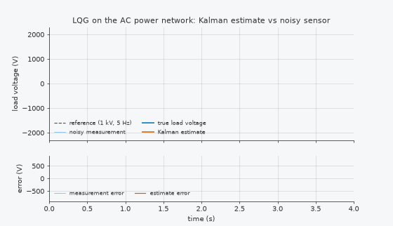

- **Problem.** Two transmission lines (100 km and 200 km) feed a series RL load from two 50 Hz, 10 kV sources. The load voltage is the output; the load voltage and load current are measured with noise.
- **Approach.** 4-state physical model, linearisation and pole/zero analysis, controllability and observability tests for any load, ZOH discretisation at 5 ms, discrete Kalman filter, LQR, and the two combined (LQG) with a feed-forward gain.
- **Results.** The model reproduces the report's steady-state load voltage (11 044 V, -55.7 deg). The system is controllable for every positive load and unobservable only at `RL = 150 LL` and `RL = 300 LL`. In 100 simulated runs the measurement-updated Kalman estimate has 154 V RMS load-voltage error against 220 V for the raw sensor. A noise-free 5 Hz reference is tracked with gain 1.00 and 9 deg lag. Everything here is a Python re-implementation of the MATLAB work; see [How to run](#how-to-run).

## Repo map

```
README.md
analysis/   Python scripts that regenerate every figure and metric (common.py holds the model and design routines)
matlab/     our MATLAB / Simulink sources from E1-E3 (not run here)
media/      all figures and the hero GIF used in this README
docs/       results.md (data sources, mismatches), report_comparison.md (report numbers vs this repo), metrics/*.json
Makefile    `make figures`
```

## Problems we had to solve

1. **Model.** Turn two pi-model transmission lines and an RL load into a state-space model, and check it against a hand calculation.
2. **Usability for control.** Linearise it and find out whether the poles and zeros allow control design.
3. **Structure.** Decide whether all states can be controlled and observed from the load voltage, for any load.
4. **Computer-ready model.** Discretise at 5 ms and see whether the discrete model is numerically sensible.
5. **Noise.** Estimate the four states from two noisy sensors, and justify the noise covariances.
6. **Control.** Make the load voltage follow a 5 Hz, 1 kV reference using the estimated states.

## Approach we took

The three assignments built on each other. E1 derived the model from Kirchhoff's laws and checked it in the Laplace domain and in simulation. E2 tested controllability and observability symbolically in the load parameters `RL`, `LL`, then discretised. E3 designed a Kalman filter and an LQR and ran them together in Simulink.

This repo adds a Python re-implementation (`analysis/`) so each result can be regenerated without MATLAB and checked against the numbers printed in the reports. The MATLAB and Simulink files are in `matlab/`.

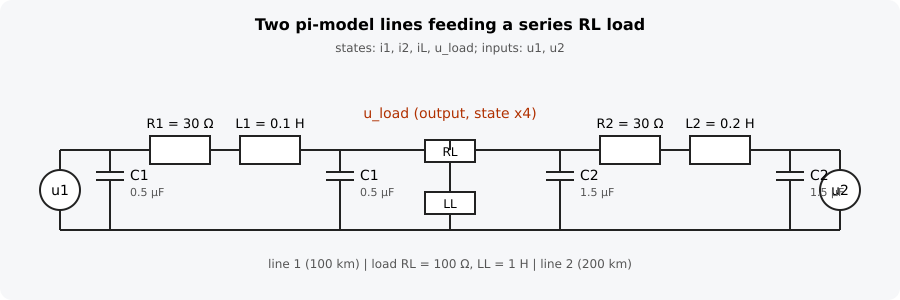

## Our solutions

### Problem 1: the model

Each line becomes `R`, `L` in series with half of the line capacitance at each end. KCL and KVL at the load give four states `x = [i1, i2, iL, u_load]` and inputs `u1 = sqrt(2) E sin(wt)`, `u2 = sqrt(2) E cos(wt)`, with E = 10 kV and 50 Hz. This solves problem 1. Solving the Laplace-domain system gives a steady-state load voltage of 11 043.98 V amplitude at -55.75 deg; a time simulation of the same model settles to the same amplitude.

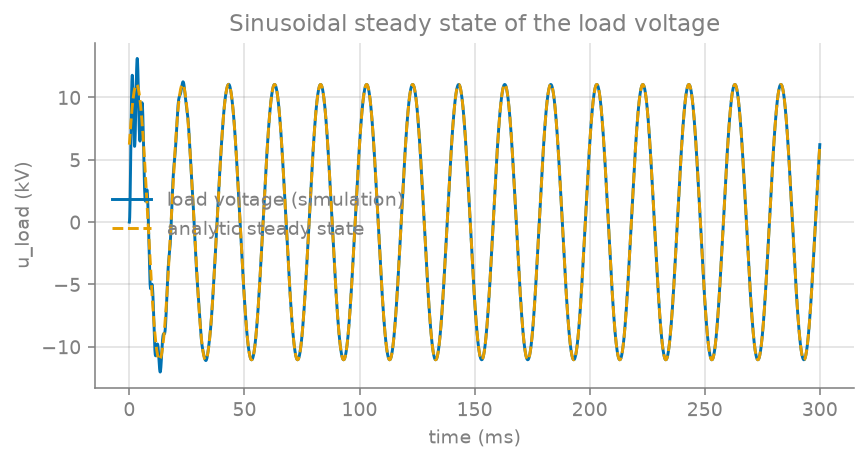

### Problem 2: linearisation, poles and zeros

The model is already linear, so the Jacobian linearisation at zero returns the same matrices (checked by finite differences). The poles are -120 +/- 2825i, -203 and -106 (1/s); the transmission zeros are -150, -100 (input 1) and -300, -100 (input 2). All are in the left half plane, no pole-zero cancellation occurs, and the system is minimum phase. This solves problem 2. A 5 Hz, 1 kV input with five different initial load voltages shows the initial difference dying out within about 0.05 s.

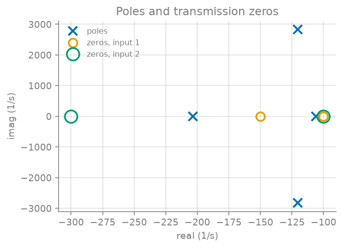
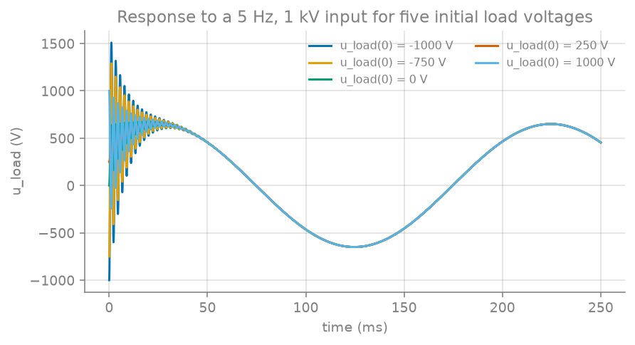

### Problem 3: controllability and observability

With `RL` and `LL` symbolic, the determinant of the observability matrix is `k (150 LL - RL)(300 LL - RL) / LL^2`. The system is therefore observable for every positive load except `RL = 150 LL` and `RL = 300 LL`. The controllability Gram determinant has only positive terms, so the system is controllable for every positive load. This solves problem 3. At the two bad loads the load pole `-RL/LL` lands on `-150` or `-300`, the poles of the line states; the system is still detectable because the unobservable mode is stable. At the nominal `RL = 100`, `LL = 1` it is controllable and observable.

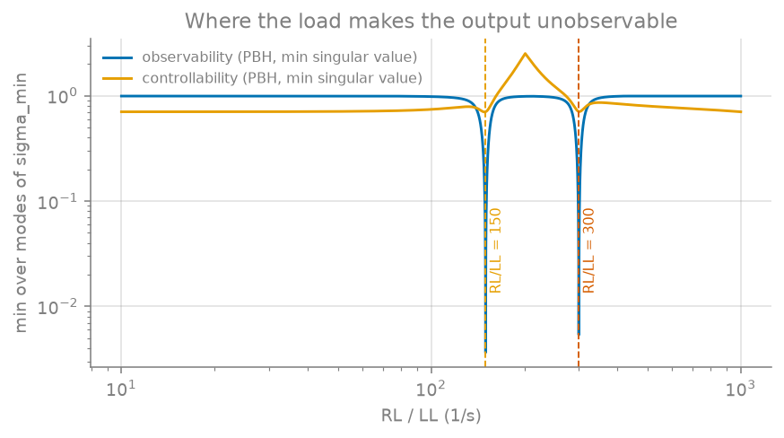

### Problem 4: discretisation

ZOH at Ts = 5 ms gives discrete eigenvalues of magnitude 0.36 to 0.59, all inside the unit circle. The condition numbers of the controllability and observability matrices drop from about 6e11 and 8e12 (continuous) to about 440 and 449 (discrete). They are still high, so the system stays hard to control numerically. This solves problem 4.

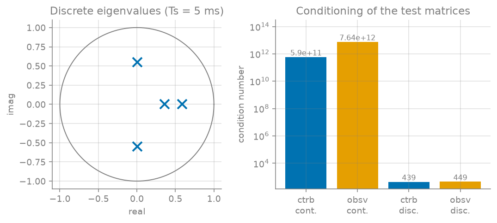

### Problems 5 and 6: Kalman filter, LQR and LQG

Process noise enters the way the input does (`Nd = Bd`), with 10 % of the maximum input as the 3-sigma level (`R1 = 222 222 I`). Measurement noise on load voltage and load current is 6 % of their steady-state magnitudes at 3 sigma (11 044 V and 33.5 A, from E1), with correlation 0.5, giving `R2 = [48 788 74.0; 74.0 0.449]`. This solves problem 5. The Kalman filter uses both sensors; the LQR penalises only the load voltage (`Qx = diag(0,0,0,1e4)`, `Qu = 0.001`) and a feed-forward gain makes the DC gain from reference to load voltage one. The control input is `u = K_FF r - L x_hat`.

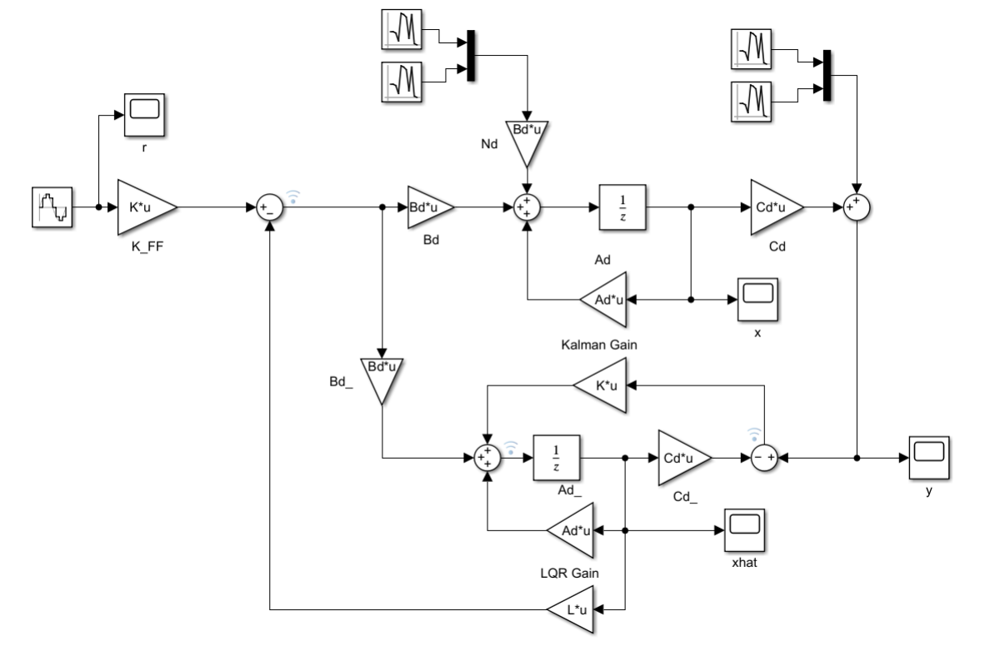

Results from 100 simulated 10 s runs (seeds fixed):

| Quantity | Value |
|---|---|
| Raw load-voltage sensor error, RMS | 220 V |
| Kalman estimate, measurement-updated, RMS error | 154 V |
| Kalman estimate, predicted (the one the controller uses), RMS error | 307 V |
| Load-voltage tracking error with noise, RMS | 335 V |
| Noise-free 5 Hz tracking | gain 1.00, lag 9 deg (one 5 ms sample), RMS error 111 V |

The predicted estimate is worse than the raw sensor; the measurement-updated one is about 30 % better. Both match the Riccati prediction (307 V and 154 V). The tracking error with noise is large because the assumed process noise (471 V standard deviation on each input) is large relative to the 1 kV reference. This solves problem 6 in simulation only: it tracks the reference, but not tightly, and nothing here ran on hardware.

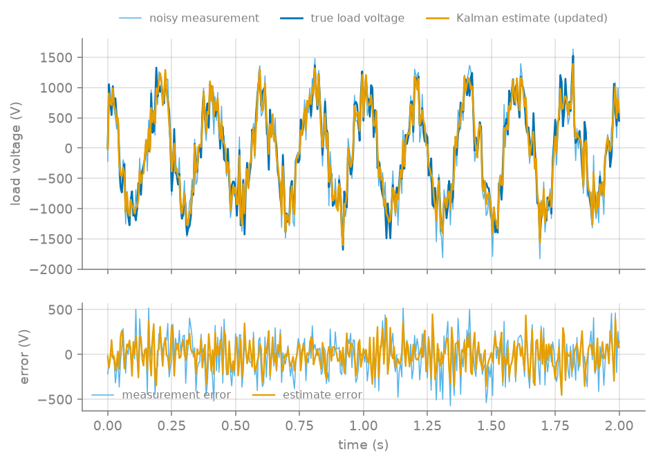
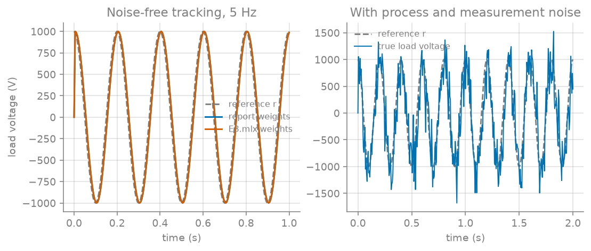
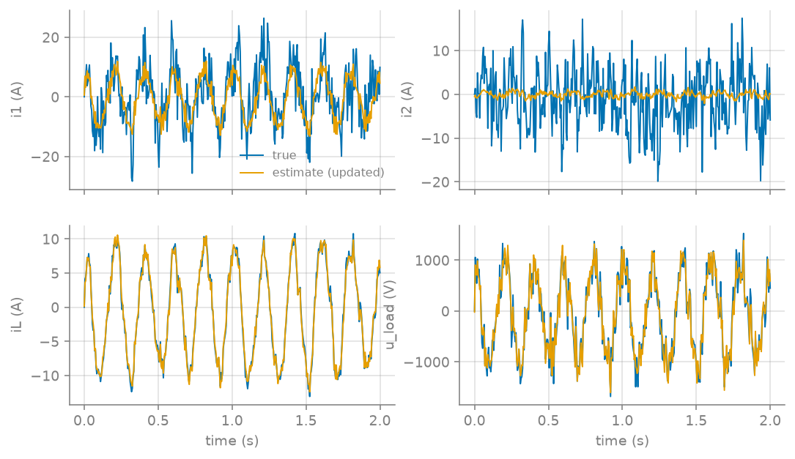

## How to run

```
python -m venv .venv && . .venv/bin/activate
pip install -r requirements.txt && make figures
```

`make figures` takes about a minute and rewrites `media/` and `docs/metrics/`.

Limitations:
- This is not a full reproduction. The MATLAB and Simulink files in `matlab/` were not run; the figures come from a Python re-implementation.
- The Simulink figure is cropped from the E3 report (command in `docs/results.md`); the report itself is not included.
- The report gives no value for `K_FF`; the Python simulation uses a minimum-norm DC feed-forward. The tracking numbers above are from that simulation, not from the report.
- Known differences from the reports (`Bd` row 4, LQR gain within 1.5 %, Kalman gain naming): see `docs/results.md` and `docs/report_comparison.md`.

## Team members

- Adyuth Hisham (repo author; contributed across E1-E3, the split between members is not recorded)
- Two teammates (names withheld)

## License

None set.
